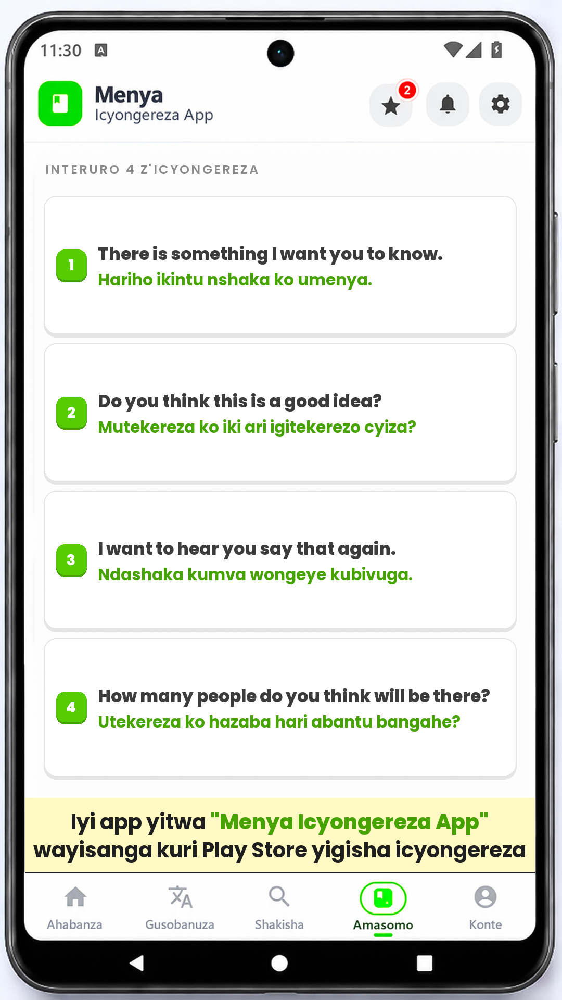

# Menya Vocab Video

Generates a 1080x1920 (9:16) Facebook/Reels-ready video that looks like the
**Menya Icyongereza App** screen:

- the app's phone mockup as the full-frame background
- **word mode:** 7 English words with their Kinyarwanda translations
- **sentence mode:** 4 English/Kinyarwanda sentence pairs (8 text lines)
- the app's chunky white cards, green number badges and dotted leaders
- an edge-to-edge yellow promo banner: *Iyi app yitwa* **"Menya Icyongereza
  App"** *wayisanga kuri Play Store yigisha icyongereza* (the app name is
  highlighted in green)

| Word mode | Sentence mode (separate rotation) |
|---|---|
|  |  |

The sentence track is a separate **18-video rotation**. Every sentence video is
exactly 4 pairs = 8 text lines: English sentence first, Kinyarwanda translation
second. The pairs are selected from the cached aligned corpus and carry the
`corpus` source tier, not a claim of native review.

Output: `output/<content_id>.mp4` — H.264, yuv420p, 30 fps, AAC stereo
audio, `+faststart`. One of the four tracks in `assets/song/` is picked at
random per run (same behaviour as the perime.rw videos). Local samples:
[`output/word_01.mp4`](output/word_01.mp4) and the old
[`output/sentence_01.mp4`](output/sentence_01.mp4) layout sample.

The current data set has two separate rotations — the untouched **1,098-video
word rotation** and the **18-video sentence rotation**:

- `data/vocabulary_all_videos.json` — 1,098 complete word videos
  (10 verified pilot videos + 1,088 generated videos)
- `data/vocabulary_all_review.md` — one-line-per-video review table and the
  1,500-word source pool
- `data/sources/` — cached English frequency list, English→Kinyarwanda
  dictionary, aligned sentence corpus, and source notes
- `data/chunks/vocabulary_chunk_01.json` … `_04.json` — four word-rotation
  chunks (2,002 / 2,002 / 2,002 / 1,680 entries)
- `data/rotation_manifest.json` — ordered `content_0001`…`content_1098` word
  jobs and the chunk map
- `data/rotation_state.json` — remembers the next word content and the cycle
- `data/vocabulary_sentences.json` - 72 curated sentence pairs → 18 sentence
  videos (4 pairs / 8 lines each)
- `data/vocabulary_sentences_review.md` — sentence review table with alignment
  notes
- `data/sentence_chunks/sentence_chunk_01.json` — one sentence-rotation chunk
  (72 pairs)
- `data/sentence_rotation_manifest.json` — ordered `sentence_0001` …
  `sentence_0018` sentence jobs
- `data/sentence_rotation_state.json` — remembers the next sentence video
- `data/vocabulary_pilot*.json` — the original 100-entry pilot, kept as the
  source of the 10 verified opening videos and the old sentence layout samples

The first 10 videos are the Glosbe-verified pilot. The other 1,088 are generated
from a **1,500-word common-vocabulary pool**; the 7,616 word slots reuse each
word 4–6 times, always in different videos. No two videos have the same
7-word set, no video repeats a word inside itself, and consecutive videos share
no words. The rotation therefore always advances to a visibly different video
and wraps from `content_1098` back to `content_0001`.

**Verification status:** the 10 pilot videos are checked against live Glosbe
pages. Generated word pairs are marked `verification: "dictionary"` in the
source database and are promoted by the build's `--trust-dictionary` flag;
their sources are the app curriculum, the cached Iriza 2006 / Cox–Adamson–Teusink
1957 dictionary, and corpus co-occurrence checks. They are not claimed as
individually native-reviewed.

The separate sentence track uses 72 curated pairs from the aligned corpus.
Each pair is marked `verification: "corpus"` in the source and promoted with
`--trust-corpus`; the manifest keeps `verification_tier: "corpus"` so the
provenance is visible. The pairs passed alignment, length, grammar, duplicate
and name/religious-term filters, and a manual scan, followed by orthographic
cleanup of missing apostrophes/spaces. They are **not** claimed as
native-verified. The 25 older `native_review_required` sentence pairs and the 6
old sentence layout samples remain outside both rotations.

## Rotation (two separate tracks, one video per run)

The word track is unchanged:

`content_0001` → `content_0002` → … → `content_1098` → `content_0001` again
(in a new cycle). Its manifest, state, IDs and 7-pair videos are exactly as
before. The current position lives in `data/rotation_state.json`; after the
latest run it points to `content_0005`.

The sentence track is independent:

`sentence_0001` → `sentence_0002` → … → `sentence_0018` → `sentence_0001`
again. Every job is exactly 4 pairs = 8 text lines, never mixed with words. Its
state lives in `data/sentence_rotation_state.json`.

Both tracks use the same state machine. State is committed only after the video
renders successfully, so a failed run repeats the same content instead of
skipping it.

- `scripts/rotation.py next` peeks at the next job and writes a one-job batch
  for `generate.py`; it does not change the state.
- `scripts/rotation.py advance` runs after encoding and moves to the next job.
- `scripts/rotation.py select --content-id content_0005` replays one specific
  content without touching the state (use a `sentence_XXXX` id with the
  sentence manifest/state).
- `scripts/rotation.py reset` starts again at the first content of that track.
- `scripts/rotation.py status` shows the remembered position.

To use the sentence track, pass its files explicitly:

```powershell
python scripts/rotation.py next `
  --manifest data/sentence_rotation_manifest.json `
  --state data/sentence_rotation_state.json `
  --out data/.sentence_job.json `
  --pending data/.sentence_pending.json

python generate.py --batch-json data/.sentence_job.json --video --duration 6

python scripts/rotation.py advance `
  --manifest data/sentence_rotation_manifest.json `
  --state data/sentence_rotation_state.json `
  --pending data/.sentence_pending.json
```

## Run it on GitHub

Choose one of the two pre-filled workflows:

1. **Menya Vocab Video** — word track (`content_0001`…`content_1098`).
2. **Menya Vocab Sentences** — sentence track (`sentence_0001`…`sentence_0018`).

For either one: open the **Actions** tab, select the workflow, leave every
field as-is, and press **Run workflow**. The run renders the next video,
commits the mp4, its preview frame and that track's updated state, and attaches
them as an artifact. The next run starts with the following content. No typing
is needed.

To replay one specific video, set `content_id` to an id from the matching
manifest (for example `content_0001` or `sentence_0001`). A replay does not
advance that track's state. Both workflows share one concurrency group, so a
word run and a sentence run cannot race on a commit.

## Inputs

| Input | Meaning | Default |
|---|---|---|
| `content_id` | Optional replay id. Empty = automatically pick the next content | empty |
| `note` | Yellow banner text. The `brand` text is highlighted in green | the Play Store hook |
| `brand` | Text to highlight green inside `note` | `Menya Icyongereza App` |
| `duration` | Video length in seconds | `6` |

## Chunk files and the manifest

The full database is split into **four** chunk files: 2,002 / 2,002 / 2,002 /
1,680 entries. Chunking uses a soft **2,000-entry target**, not an exact 300
cap; a chunk may go over the target so a 7-word video is never split. The
manifest lists every `content_0001`…`content_1098` job and points back to its
chunk file and job index. The workflow validates all 1,098 unique video
signatures and the four chunk files before rendering.

```powershell
python scripts/build_chunks.py `
  --input data/vocabulary_all_videos.json `
  --out-dir data/chunks `
  --manifest data/rotation_manifest.json `
  --state data/rotation_state.json `
  --chunk-size 2000 `
  --allow-shared-entries `
  --trust-dictionary `
  --start-content content_0005
```

The builder is verification-gated by default: it keeps only content marked
`verification: "verified"`. `--trust-dictionary` promotes pairs marked
`verification: "dictionary"` for this database; `--include-unverified` remains
for review/layout builds only (never for publishing). Excluded entries, skipped
sentence videos and counts are recorded in the manifest `meta`; the workflow
summary shows the same numbers. Use `--start-content` with the current
`next_content_id` from `data/rotation_state.json` (currently `content_0005`)
when migrating the existing rotation so already-rendered videos are not
replayed.

Duplicate videos are rejected even with `--allow-shared-entries`: every video
signature must be unique. The generated word database intentionally reuses
words across non-adjacent videos, but no video repeats the same 7-word set and
consecutive videos share no words. Without `--allow-shared-entries` the builder
also rejects any repeated word/sentence anywhere in the database.

### Sentence track

The sentence track is built separately so it cannot change the word manifest or
state. It has **one** chunk with 72 pairs and 18 complete 4-pair videos:

```powershell
python scripts/build_sentence_database.py

python scripts/build_chunks.py `
  --input data/vocabulary_sentences.json `
  --out-dir data/sentence_chunks `
  --manifest data/sentence_rotation_manifest.json `
  --state data/sentence_rotation_state.json `
  --chunk-size 2000 `
  --allow-shared-entries `
  --trust-corpus `
  --id-prefix sentence_ `
  --chunk-prefix sentence_chunk_
```

`--trust-corpus` promotes the source pairs from `verification: "corpus"` to the
publishing gate for this build; `verification_tier` stays `"corpus"` so the
workflow summary and review table never pretend the sentences were native
reviewed. `--id-prefix sentence_` keeps ids and output filenames separate from
the word rotation. The sentence builder refuses a partial final video: a
remainder is dropped rather than published with fewer than 4 pairs.

Each job looks like this:

```json
{
  "id": "content_0001",
  "content_number": 1,
  "mode": "word",
  "pair_count": 7,
  "entry_start": 1,
  "entry_end": 7,
  "pairs": [
    {
      "english": "secretary",
      "kinyarwanda": "umunyamabanga",
      "verification": "verified"
    }
  ]
}
```

- Word jobs: `mode: "word"`, 7 pairs. The word track never contains sentences.
- Sentence jobs: `mode: "sentence"`, 4 pairs = 8 text lines (English first,
  Kinyarwanda second). The sentence track never contains word-only jobs.
- A final partial job is allowed only when a database does not divide evenly;
  it is labelled with its real pair count and its cards are centred. The
  sentence track deliberately drops a remainder instead, so every published
  sentence video is exactly 4 pairs.
- Directions are always English → Kinyarwanda.
- `generate.py` accepts 1–7 word pairs or 1–4 sentence pairs for manual
  previews; the rotations themselves only contain complete jobs.

## Rebuild the database from the cached sources

The 1,098-video database is generated deterministically from the files in
`data/sources/` (about 4.2 MB on disk; see `data/sources/README.md` for
provenance and sizes):

```powershell
python scripts/build_full_database.py
```

- 622 KB English frequency list (GitHub `hermitdave/FrequencyWords`)
- 19,849-pair English→Kinyarwanda dictionary cache
- 458 curriculum pairs used as the high-confidence seed
- 14,411 aligned English/Kinyarwanda sentences used to check word senses
- a small corpus-backed override list for dictionary senses such as
  *high → hejuru*, *effect → ingaruka*, and *plant → igihingwa*

The generator is seeded (`20261021`). It keeps the 10 verified pilot videos,
adds 1,088 generated 7-word videos, and refuses to write a database unless every
video is complete, all 1,098 signatures are unique, and consecutive videos share
no words. Output:

- `data/vocabulary_all_videos.json`
- `data/vocabulary_all_review.md`

Then rebuild the four word chunks and the manifest with the command in the
previous section.

The sentence source is rebuilt separately and deterministically from the same
cached corpus:

```powershell
python scripts/build_sentence_database.py
```

It selects the 72 curated pairs, applies the orthographic cleanup table, writes
`data/vocabulary_sentences.json` and `data/vocabulary_sentences_review.md`, and
refuses to write a partial final video. Then run the sentence chunk command from
the previous section. Rebuilding the sentence source does **not** touch
`data/vocabulary_all_videos.json`, the word chunks, the word manifest, or the
word state.

## Run locally

Requires Python 3.10+, Pillow and ffmpeg.

```powershell
pip install -r requirements.txt

# Pick the next content (writes a temporary one-job batch)
python scripts/rotation.py next `
  --out data/.current_job.json `
  --pending data/.rotation_pending.json

# Render its preview and mp4
python generate.py --batch-json data/.current_job.json --video

# Advance only after the render succeeded
python scripts/rotation.py advance --pending data/.rotation_pending.json
```

You can still render one of the old pilot batches directly. Its sentence batch
is a layout sample only; the live sentence rotation is the separate 18-video
track built from `data/vocabulary_sentences.json`.

```powershell
# word mode (7 pairs, verified)
python generate.py --batch-json data/vocabulary_pilot_videos.json --video-id word_01 --video

# old sentence layout sample (not the live sentence rotation)
python generate.py --batch-json data/vocabulary_pilot_videos.json --video-id sentence_01 --video

# live sentence rotation: peek, render, advance
python scripts/rotation.py next `
  --manifest data/sentence_rotation_manifest.json `
  --state data/sentence_rotation_state.json `
  --out data/.sentence_job.json `
  --pending data/.sentence_pending.json
python generate.py --batch-json data/.sentence_job.json --video
python scripts/rotation.py advance `
  --manifest data/sentence_rotation_manifest.json `
  --state data/sentence_rotation_state.json `
  --pending data/.sentence_pending.json
```

Custom content without the batch JSON still works:

```powershell
# word mode, up to 7 pairs
python generate.py --pairs "Book=Igitabo; Water=Amazi"

# sentence mode, up to 4 pairs
python generate.py --mode sentence --pairs "Where does it hurt?=Uri kubabara he?; He cooks food.=Ateka ibiryo; I drink tea.=Nnywa icyayi; Good morning.=Mwaramutse"
```

## How the layout works

The background is 720x1280, so everything is drawn on a 1080x1920 canvas
(1.5x) to keep text sharp. The usable app body was measured from the mockup:
x 32–685, y 183–1115. The rows use that area with 36 px side padding; the
promo banner runs edge-to-edge and sits on the tab bar divider.

### Word mode

- Section label: `AMAGAMBO 7 Y'ICYONGEREZA`, uppercase, tracked, muted.
- 7 rows: white card, 2 px `#E5E5E5` border, hard offset shadow, 3D green
  number badge, English in Poppins ExtraBold, Kinyarwanda in Poppins Bold
  green, dotted leader between them.
- Long words shrink automatically (46→26 px English, 42→24 px Kinyarwanda)
  so a pair can never overflow the card.
- A short final job with fewer than 7 words is centred vertically instead of
  leaving all the empty space at the bottom.

### Sentence mode

- Section label: `INTERURO 4 Z'ICYONGEREZA`, uppercase, tracked, muted.
- 4 cards, one per pair. Each card has exactly one English line followed by
  one Kinyarwanda line, so one pair always reads as two lines.
- English is Poppins ExtraBold dark; Kinyarwanda is Poppins Bold green.
- Text never wraps. The renderer picks the largest shared font size for all
  four cards (starting at 46 px) that keeps every English and Kinyarwanda line
  inside the card. This keeps the four cards even instead of shrinking each
  one separately. A future pair that cannot fit at the minimum size fails the
  build rather than overflowing.
- Number badges, borders and shadows match the word cards.
- Manual sentence batches with fewer than 4 pairs are centred vertically; the
  live sentence rotation never contains a partial job.

### Promo banner

- Edge-to-edge `#FFF9C4` banner with square corners, no side or top border,
  a single black rule along the bottom, and the text set on two lines at the
  largest size that fits (8 px side padding), brand name highlighted in green.
- Rows are sized from the space left above the promo banner, so the layout
  stays balanced without manual tweaking.

## Customizing

| What | Where |
|---|---|
| Colors | token block at the top of `generate.py` (`GREEN`, `BORDER`, `YELLOW`, …) |
| Fonts | `assets/fonts/` (Poppins, OFL — see `OFL.txt`) |
| Background | `assets/img/background.png` (keep the same 720x1280 screen position, or update `BODY`) |
| Music | drop `.mp3/.m4a/.wav` files into `assets/song/`; one is picked at random. Empty = silent |
| Video length | `--duration` / the `duration` input |
| Video content | edit `data/vocabulary_all_videos.json` (words) or `data/vocabulary_sentences.json` (sentences), then rebuild with `scripts/build_chunks.py` |
| Rotation order | `data/rotation_manifest.json` or `data/sentence_rotation_manifest.json` (generated); reset with `scripts/rotation.py reset` |

## Files

```
generate.py                     renderer + ffmpeg encoder
scripts/build_full_database.py  builds the 1,098-video word database from cached sources
scripts/build_sentence_database.py  builds the 72-pair sentence database from the corpus
scripts/build_chunks.py         splits videos into chunk files + manifest/state
scripts/rotation.py             next/advance/select/status/reset state machine
data/vocabulary_all_videos.json 1,098-video word database (10 pilot + 1,088 generated)
data/vocabulary_all_review.md   word-pool and one-line-per-video review tables
data/vocabulary_sentences.json  72 curated sentence pairs -> 18 videos
data/vocabulary_sentences_review.md  sentence review table
data/sources/                   frequency list, dictionary cache, corpus, provenance
data/chunks/*.json              four word-rotation chunks (complete videos only)
data/rotation_manifest.json     ordered word content ids + chunk map
data/rotation_state.json        remembered next word content and cycle
data/sentence_chunks/*.json     one sentence-rotation chunk
data/sentence_rotation_manifest.json  ordered sentence content ids + chunk map
data/sentence_rotation_state.json     remembered next sentence video and cycle
data/vocabulary_pilot.json      original flat 100-entry pilot
data/vocabulary_pilot_videos.json   original word/sentence batches + layout samples
data/*_review.md                human-readable review tables
scripts/build_pilot.py          builds the flat pilot
scripts/build_video_batches.py  builds the original video batches
assets/img/background.png       phone mockup background
assets/fonts/Poppins-*.ttf      bundled fonts (OFL)
assets/song/                    optional music
preview/*.png                   rendered frames
output/*.mp4                    generated videos
.github/workflows/menyavocab.yml
.github/workflows/menyavocab_sentences.yml
```

## Notes

- 9:16 — ready for Facebook Reels, Stories and feed.
- A track from `assets/song/` is mixed automatically; if the folder is empty,
  the video is silent.
- Poppins is licensed under the SIL Open Font License 1.1
  (`assets/fonts/OFL.txt`).
- Both workflows share one concurrency group, so two runs cannot race on a
  commit. Each track's state is committed only after a successful render.
- The 1,098-video word rotation is unchanged: same manifest, same ids, same
  7-pair videos, same state, and no slash glosses removed. The sentence track
  is separate so it cannot renumber or disturb it.
- The 25 older `native_review_required` sentence pairs and the 6 old sentence
  layout samples remain outside both rotations.
- Generated word pairs are dictionary/corpus sourced; sentence pairs are
  corpus-sourced. Neither is individually native-reviewed. Use
  `data/vocabulary_all_review.md` and `data/vocabulary_sentences_review.md` to
  spot-check before treating every translation as final.
