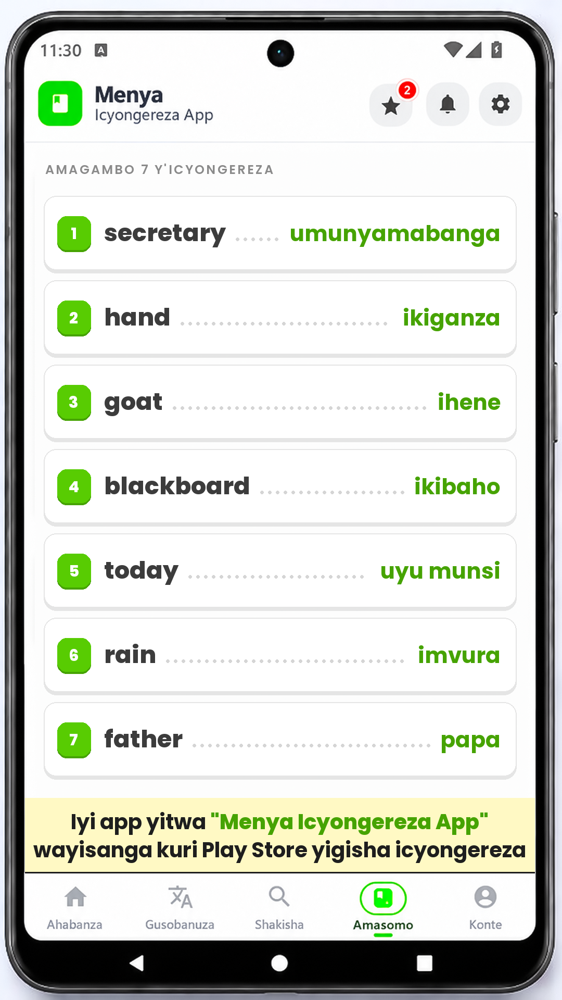
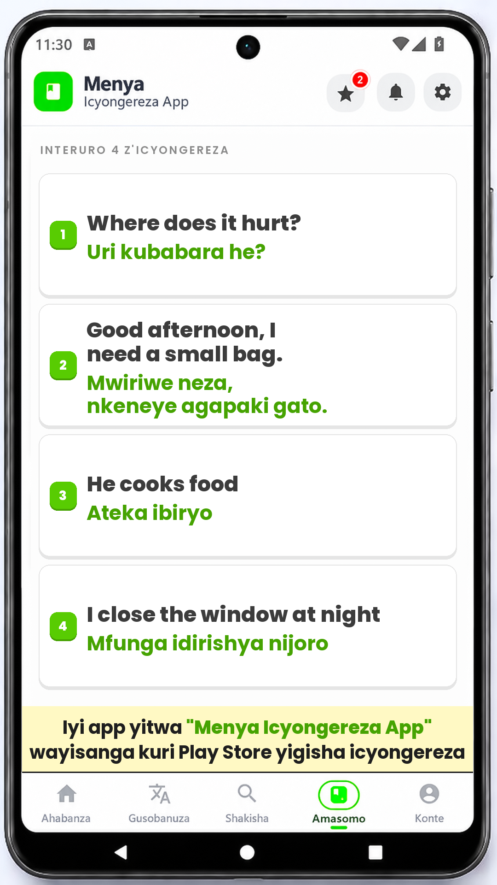

# Menya Vocab Video

Generates a 1080x1920 (9:16) Facebook/Reels-ready video that looks like the
**Menya Icyongereza App** screen:

- the app's phone mockup as the full-frame background
- **word mode:** 7 English words with their Kinyarwanda translations
- **sentence mode:** 4 English/Kinyarwanda sentence pairs (8 text lines)
- the app's chunky white cards, green number badges and dotted leaders
- an edge-to-edge yellow promo banner: *Iyi app yitwa* **"Menya Icyongereza
  App"** *wayisanga kuri Play Store yigisha icyongereza* (the app name is
  highlighted in green)

| Word mode | Sentence mode |
|---|---|
|  |  |

Output: `output/<video_id>.mp4` — H.264, yuv420p, 30 fps, AAC stereo audio,
`+faststart`. One of the four tracks in `assets/song/` is picked at random per
run (same behaviour as the perime.rw videos). Local samples:
[`output/word_01.mp4`](output/word_01.mp4) and
[`output/sentence_01.mp4`](output/sentence_01.mp4).

The current data set is the **100-entry pilot**:

- `data/vocabulary_pilot.json` — 100 flat entries (74 words + 26 sentence pairs)
- `data/vocabulary_pilot_videos.json` — 10 complete word videos, 6 complete
  sentence videos, plus a remainder bucket
- `data/vocabulary_pilot_review.md` and
  `data/vocabulary_pilot_videos_review.md` — human-readable review tables

**Verification status:** 75 entries are checked against live Glosbe pages.
The other 25 sentence pairs are marked `native_review_required`; they are not
claimed as online-verified until a native speaker reviews them.

## Run it on GitHub (first time)

1. Open the repo's **Actions** tab → **Menya Vocab Video** → **Run workflow**.
2. Leave every field as-is. The defaults load
   `data/vocabulary_pilot_videos.json` and render `word_01`.
3. Press **Run workflow**.

No typing is needed for the default word video. To render a sentence video,
change only `video_id` to `sentence_01` (or any id from
`sentence_01`…`sentence_06`).

The run commits the mp4 and its preview frame back into the repo and also
attaches them as the `menya-vocab-video` artifact.

## Inputs

| Input | Meaning | Default |
|---|---|---|
| `batch_file` | Batch JSON path in the repo | `data/vocabulary_pilot_videos.json` |
| `video_id` | Batch id: `word_01`…`word_10` or `sentence_01`…`sentence_06` | `word_01` |
| `note` | Yellow banner text. The `brand` text is highlighted in green | the Play Store hook |
| `brand` | Text to highlight green inside `note` | `Menya Icyongereza App` |
| `duration` | Video length in seconds | `6` |

## Batch JSON

Each video carries its own mode and exactly the right number of pairs:

```json
{
  "id": "sentence_01",
  "mode": "sentence",
  "pair_count": 4,
  "pairs": [
    {
      "english": "Where does it hurt?",
      "kinyarwanda": "Uri kubabara he?"
    }
  ]
}
```

- Word batch: `mode: "word"`, `pair_count: 7`.
- Sentence batch: `mode: "sentence"`, `pair_count: 4`.
- Directions are always English → Kinyarwanda.
- `generate.py` refuses a batch whose pair count does not match its mode.

## Run locally

Requires Python 3.10+, Pillow and ffmpeg.

```powershell
pip install -r requirements.txt

# word mode (7 pairs)
python generate.py --batch-json data/vocabulary_pilot_videos.json --video-id word_01 --video

# sentence mode (4 pairs / 8 lines)
python generate.py --batch-json data/vocabulary_pilot_videos.json --video-id sentence_01 --video
```

Custom content without the batch JSON still works:

```powershell
# word mode, up to 7 pairs
python generate.py --pairs "Book=Igitabo; Water=Amazi"

# sentence mode, exactly 4 pairs
python generate.py --mode sentence --pairs "Where does it hurt?=Uri kubabara he?; He cooks food.=Ateka ibiryo; I drink tea.=Nnywa icyayi; Good morning.=Mwaramutse"
```

## How the layout works

The background is 720x1280, so everything is drawn on a 1080x1920 canvas
(1.5x) to keep text sharp. The usable app body was measured from the mockup:
x 32–685, y 183–1115. The rows use that area with 36 px side padding; the
promo banner runs edge-to-edge and sits on the tab bar divider.

### Word mode

- Section label: `AMAGAMBO 7 Y'ICYONGEREZA`, uppercase, tracked, muted.
- 7 rows: white card, 2 px `#E5E5E5` border, hard offset shadow, 3D green
  number badge, English in Poppins ExtraBold, Kinyarwanda in Poppins Bold
  green, dotted leader between them.
- Long words shrink automatically (46→26 px English, 42→24 px Kinyarwanda)
  so a pair can never overflow the card.

### Sentence mode

- Section label: `INTERURO 4 Z'ICYONGEREZA`, uppercase, tracked, muted.
- 4 cards, one per pair. Each card stacks the English sentence above the
  Kinyarwanda sentence, so one pair always reads as two lines.
- English is Poppins ExtraBold dark; Kinyarwanda is Poppins Bold green.
- Text wraps and shrinks (46→22 px) until both languages fit inside the card.
- Number badges, borders and shadows match the word cards.

### Promo banner

- Edge-to-edge `#FFF9C4` banner with square corners, no side or top border,
  a single black rule along the bottom, and the text set on two lines at the
  largest size that fits (8 px side padding), brand name highlighted in green.
- Rows are sized from the space left above the promo banner, so the layout
  stays balanced without manual tweaking.

## Customizing

| What | Where |
|---|---|
| Colors | token block at the top of `generate.py` (`GREEN`, `BORDER`, `YELLOW`, …) |
| Fonts | `assets/fonts/` (Poppins, OFL — see `OFL.txt`) |
| Background | `assets/img/background.png` (keep the same 720x1280 screen position, or update `BODY`) |
| Music | drop `.mp3/.m4a/.wav` files into `assets/song/`; one is picked at random. Empty = silent |
| Video length | `--duration` / the `duration` input |
| Video content | edit `data/vocabulary_pilot_videos.json` or pass `--pairs` |

## Files

```
generate.py                     renderer + ffmpeg encoder
data/vocabulary_pilot.json      flat 100-entry database
data/vocabulary_pilot_videos.json   video-ready word/sentence batches
data/*_review.md                human-readable review tables
scripts/build_pilot.py          builds the flat pilot
scripts/build_video_batches.py  builds the video batches
assets/img/background.png       phone mockup background
assets/fonts/Poppins-*.ttf      bundled fonts (OFL)
assets/song/                    optional music
preview/*.png                   rendered frames
output/*.mp4                    generated videos
.github/workflows/menyavocab.yml
```

## Notes

- 9:16 — ready for Facebook Reels, Stories and feed.
- A track from `assets/song/` is mixed automatically; if the folder is empty,
  the video is silent.
- Poppins is licensed under the SIL Open Font License 1.1
  (`assets/fonts/OFL.txt`).
- The full 1,098-entry database is the next build step; this repo currently
  ships the reviewed 100-entry pilot.
