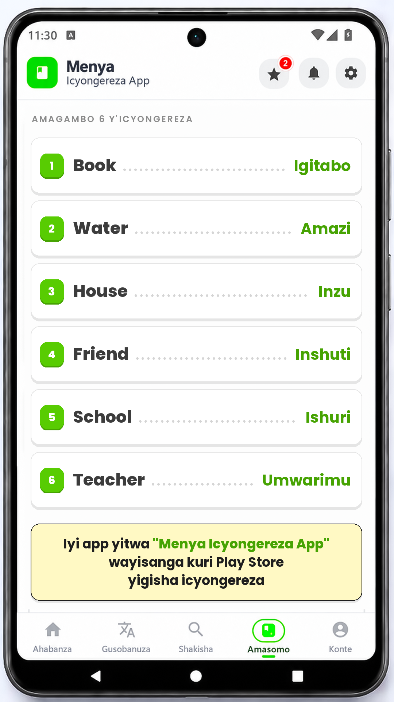

# Menya Vocab Video

Generates a 1080x1920 (9:16) Facebook/Reels-ready video that looks like the
**Menya Icyongereza App** screen:

- the app's phone mockup as the full-frame background
- 6 (up to 6) English words with their Kinyarwanda translations
- the app's chunky white cards, green number badges and dotted leaders
- a yellow promo box: *Iyi app yitwa* **"Menya Icyongereza App"** *wayisanga
  kuri Play Store yigisha icyongereza* (the app name is highlighted in green)



Output: `output/menya_vocab_<timestamp>.mp4` — H.264, yuv420p, 30 fps,
AAC stereo audio, `+faststart`. One of the four tracks in `assets/song/`
is picked at random per run (same behaviour as the perime.rw videos).

A sample rendered with the test content is in
[`output/menya_vocab_sample.mp4`](output/menya_vocab_sample.mp4).

## Run it on GitHub (first time)

1. Open the repo's **Actions** tab → **Menya Vocab Video** → **Run workflow**.
2. Leave every field as-is (they are pre-filled with test content).
3. Press **Run workflow**.

No typing is needed: the workflow inputs already contain this test set:

| English | Kinyarwanda |
|---|---|
| Book | Igitabo |
| Water | Amazi |
| House | Inzu |
| Friend | Inshuti |
| School | Ishuri |
| Teacher | Umwarimu |

The run commits the mp4 and the preview frame back into the repo and also
attaches them as the `menya-vocab-video` artifact.

## Inputs

| Input | Meaning | Default |
|---|---|---|
| `pairs` | `English=Kinyarwanda` pairs separated by `;` (max 6) | the test set above |
| `note` | Yellow box text. The `brand` text is highlighted in green | the Play Store hook |
| `brand` | Text to highlight green inside `note` | `Menya Icyongereza App` |
| `duration` | Video length in seconds | `6` |

Example:

```
Book=Igitabo; Water=Amazi; House=Inzu; Friend=Inshuti; School=Ishuri; Teacher=Umwarimu
```

## Run locally

Requires Python 3.10+, Pillow and ffmpeg.

```powershell
pip install -r requirements.txt
python generate.py --preview preview/preview.png
python generate.py --video
```

Custom content:

```powershell
python generate.py --pairs "Book=Igitabo; Water=Amazi" --note "Ushaka kwiga icyongereza wakoresha iyi app yitwa Menya Icyongereza App" --video
```

## How the layout works

The background is 720x1280, so everything is drawn on a 1080x1920 canvas
(1.5x) to keep text sharp. The usable app body was measured from the mockup:
x 32–685, y 183–1115. The generator draws only inside that area, with 36 px
side padding.

- Section label: `AMAGAMBO <n> Y'ICYONGEREZA`, uppercase, tracked, muted.
- Rows: white card, 2 px `#E5E5E5` border, hard offset shadow, 3D green
  number badge, English in Poppins ExtraBold, Kinyarwanda in Poppins Bold
  green, dotted leader between them.
- Long words shrink automatically (46→26 px English, 42→24 px Kinyarwanda)
  so a pair can never overflow the card.
- Promo: `#FFF9C4` box, 2 px black border, balanced line wrapping (no orphan
  words), brand name highlighted in green.
- Rows are sized from the space left above the promo box, so 1–6 pairs all
  fit without manual tweaking.

## Customizing

| What | Where |
|---|---|
| Colors | token block at the top of `generate.py` (`GREEN`, `BORDER`, `YELLOW`, …) |
| Fonts | `assets/fonts/` (Poppins, OFL — see `OFL.txt`) |
| Background | `assets/img/background.png` (keep the same 720x1280 screen position, or update `BODY`) |
| Music | drop `.mp3/.m4a/.wav` files into `assets/song/`; one is picked at random. Empty = silent |
| Video length | `--duration` / the `duration` input |
| Number of words | pass 1–6 pairs; the label and row heights adapt |

## Files

```
generate.py                     renderer + ffmpeg encoder
assets/img/background.png       phone mockup background
assets/fonts/Poppins-*.ttf      bundled fonts (OFL)
assets/song/                    optional music
preview/preview.png             latest rendered frame
output/*.mp4                    generated videos
.github/workflows/menyavocab.yml
```

## Notes

- 9:16 — ready for Facebook Reels, Stories and feed.
- The video is silent by default. Add a track to `assets/song/` if you want
  music like the perime.ru videos.
- Poppins is licensed under the SIL Open Font License 1.1 (`assets/fonts/OFL.txt`).
